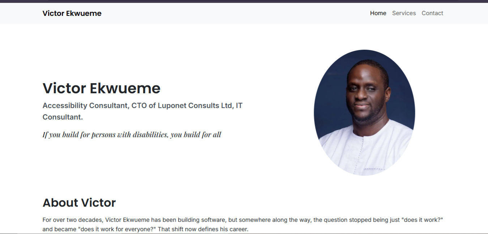
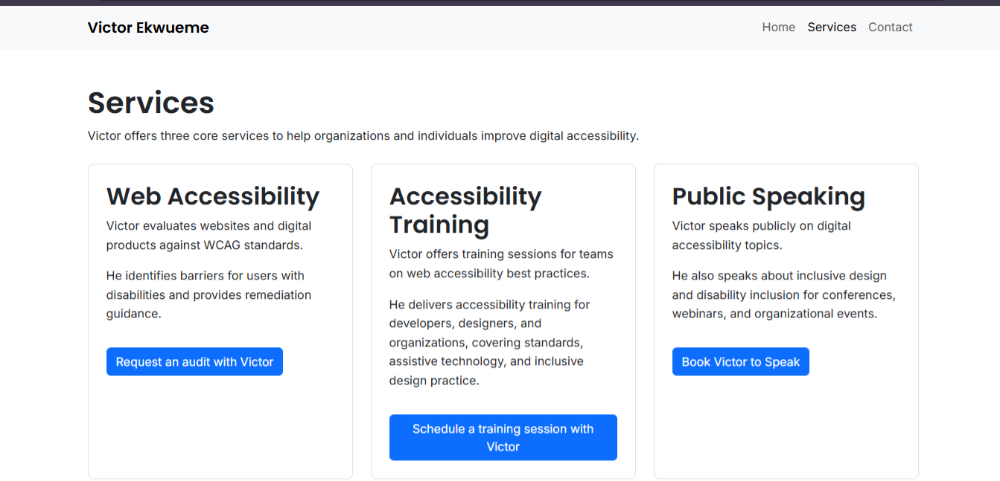
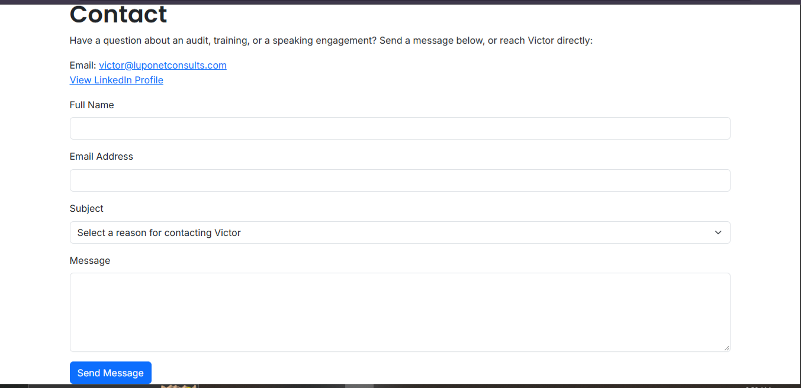

# Accessibility Consultant Website

A professional website for a web accessibility consultant, built with Python, Flask and Jinja2. The site presents the consultant's profile, services and a contact form, and it is designed to follow WCAG 2.1 AA accessibility practices because accessibility is the service being offered.

## Features

- **Home page** with a profile, credentials and links to the consultant's book and social profiles.
- **Services page** covering three offerings: web accessibility audits, accessibility training and public speaking.
- **Contact form** with server-side validation, clear error and success messages, and email delivery over SMTP.
- **Spam protection** using a hidden honeypot field.
- **Works without JavaScript.** JavaScript is only used for small enhancements such as highlighting the current page in the menu.

## Accessibility Practices

- Semantic HTML5 structure (`header`, `nav`, `main`, `footer`).
- "Skip to main content" link for keyboard users.
- Every form field has a visible label, and error messages are linked to their fields.
- Status and error messages use `role="status"` and `role="alert"`.
- Descriptive alt text on images and descriptive link text.
- Visible keyboard focus styles and sufficient colour contrast.
- Responsive layout built with Bootstrap 5.

## Screenshots

### Home Page


### Services


### Contact


## Technologies Used

| Technology | Purpose |
|------------|---------|
| HTML5 | Page structure |
| CSS3 and Bootstrap 5 | Styling and responsive layout |
| JavaScript | Progressive enhancement |
| Python | Backend logic |
| Flask | Web framework and routing |
| Jinja2 | Template rendering |
| SMTP (Gmail) | Sending contact form messages |

## Project Structure

```
accessibility-consultant-website/
├── app.py
├── requirements.txt
├── .env.example
├── templates/
│   ├── base.html
│   ├── index.html
│   ├── services.html
│   └── contact.html
├── static/
│   ├── style.css
│   ├── script.js
│   └── images/
├── screenshots/
└── README.md
```

## Getting Started

### Prerequisites
- Python 3 installed.
- Git installed.
- A Gmail account with an [App Password](https://support.google.com/accounts/answer/185833) for sending emails.

### 1. Clone the Repository

```
git clone https://github.com/Tobiloba2104/accessibility-consultant-website.git
cd accessibility-consultant-website
```

### 2. Create a Virtual Environment

```
py -m venv venv
venv\Scripts\activate
```

### 3. Install the Requirements

```
py -m pip install -r requirements.txt
```

### 4. Set Up Your Environment Variables

Make a copy of `.env.example` and name it `.env`, then fill in your own details:

```
MAIL_USERNAME=your-email@gmail.com
MAIL_PASSWORD=your-gmail-app-password
```

The `.env` file is private and is not uploaded to GitHub.

### 5. Run the Application

```
py app.py
```

Open the local address shown in the terminal in your browser.

## Future Improvements

- Keep the typed values in the contact form after a validation error.
- Add an accessibility statement page.
- Deploy the site for public access.

## Developer

**Adebesin Oluwatobiloba**
Final-year Computer Science student | Python Developer | Aspiring Backend Developer
